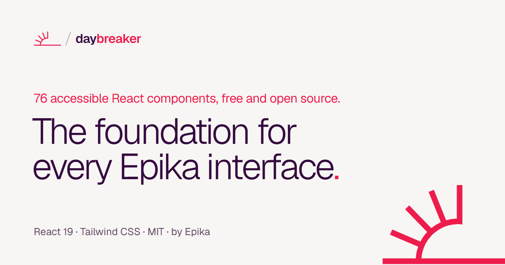

# daybreaker

[](https://www.npmjs.com/package/daybreaker)
[](https://github.com/epika-ad/epika-daybreaker/actions/workflows/ci.yml)
[](LICENSE)

[](https://daybreaker.epika.ad)

The kit we build client work on, now yours. 76 accessible React components from [Epika](https://epika.ad), a creative studio in Tirana. Built on [Base UI](https://base-ui.com), styled with Tailwind CSS v4, MIT licensed.

Keyboard navigation, focus management and screen reader support are built in. The look comes from a small set of design tokens you can override.

**[Docs and live previews](https://daybreaker.epika.ad)** · **[Components](https://daybreaker.epika.ad/#/components)** · **[Figma file](https://daybreaker.epika.ad/#/figma)** · **[npm](https://www.npmjs.com/package/daybreaker)**

## Install

```sh
npm install daybreaker
```

Requires React 19.

## Set up styles

**With Tailwind CSS v4:** import the theme after Tailwind. It registers the tokens and tells Tailwind to scan the library's classes:

```css
@import "tailwindcss";
@import "daybreaker/theme.css";
```

**Without Tailwind:** import the precompiled stylesheet once, at the root of your app:

```ts
import "daybreaker/styles.css";
```

## Use

```tsx
import { Button, Dialog, DialogPopup, DialogTitle, DialogTrigger } from "daybreaker";

export const Example = () => (
  <Dialog>
    <DialogTrigger render={<Button variant="outline" />}>Open</DialogTrigger>
    <DialogPopup>
      <DialogTitle>Hello</DialogTitle>
    </DialogPopup>
  </Dialog>
);
```

Toasts and tooltips need their providers once, near the root:

```tsx
import { ToastProvider, TooltipProvider } from "daybreaker";

export const Providers = ({ children }) => (
  <TooltipProvider>
    <ToastProvider>{children}</ToastProvider>
  </TooltipProvider>
);
```

## Next.js

The bundle is marked `"use client"`, so components can be imported straight into a Server Component in the App Router. Two rules from React Server Components still apply:

- Helpers such as `cn`, `cva` and `buttonVariants` cannot be called inside a Server Component. Call them from a file that starts with `"use client"`.
- Props that are functions, such as `onClick` or a DataTable's `rowKey`, have to be passed from a Client Component.

## Components

76 components in 7 groups. Each one has a live preview and its code on the docs site.

| Group | Components |
| ----- | ---------- |
| Actions | Button, Toggle, Toggle Group, Button Group, Toolbar |
| Forms | Field, Form, Label, Input, Input Group, Textarea, Select, Native Select, Combobox, Checkbox, Radio, Switch, Slider, Number Field, OTP Field, Fieldset, Calendar, Date Picker |
| Overlays | Dialog, Alert Dialog, Drawer, Command, Popover, Tooltip, Preview Card, Menu, Context Menu, Toast |
| Navigation | Navbar, Navigation Menu, Menubar, Sidebar, Tabs, Accordion, Collapsible, Breadcrumb, Pagination |
| Conversation | Message, Bubble, Marker, Attachment, Message Scroller, Questionnaire |
| Charts | Area Charts, Bar Charts, Line Charts, Pie Charts, Radar Charts, Radial Charts, Chart Tooltips |
| Display | Card, Item, Empty, Carousel, Aspect Ratio, Resizable, Typography, Direction, Badge, Avatar, Alert, Table, Data Table, Chart, Separator, Scroll Area, Kbd, Progress, Meter, Skeleton, Spinner |

The chart components in the Charts group are built on [Recharts](https://recharts.org) and live in their own entry point, so apps that draw no charts do not install it:

```sh
npm install recharts
```

```tsx
import { ChartContainer, ChartTooltip, ChartTooltipContent } from "daybreaker/charts";
```

Also exported: `ThemeProvider`, `useTheme`, `useToast`, `DirectionProvider`, `cn`, `cva` and the icons.

## Figma

The same components as a Figma file you can duplicate and make your own: every component with its variants, the tokens as variables with Light and Dark modes, and a foundations page. [Get it on the docs site](https://daybreaker.epika.ad/#/figma) and we'll email you the link.

## Use it with AI assistants

The [skill/](skill/) folder teaches an AI assistant to build with daybreaker: setup, how the components fit together, theming, Next.js rules, and every component's props and working example.

- **Claude (claude.ai):** Settings → Capabilities → Skills → upload [skill/daybreaker.zip](skill/daybreaker.zip).
- **Claude Code:** copy [skill/daybreaker/](skill/daybreaker/) into `~/.claude/skills/` (for you) or `.claude/skills/` (for one project).
- **ChatGPT and other assistants:** add [skill/daybreaker-single-file.md](skill/daybreaker-single-file.md) to a project's files or a custom GPT's knowledge.

The skill is generated from the library; run `npm run build:skill` after changing components or examples.

## Customise

Every component accepts `className`; components with inner parts also accept `classList` to target them:

```tsx
<Checkbox classList={{ root: "size-6", indicator: "text-white" }} />
```

To rebrand, override the tokens:

```css
:root {
  --wz-primary: oklch(0.6 0.2 150);
  --wz-radius: 0.75rem;
}
```

The full token list lives in [src/styles/theme.css](src/styles/theme.css).

## Dark mode

Add the `dark` class to `<html>`, or let `ThemeProvider` manage it (light, dark, or follow the system) and read it with `useTheme()`.

## Develop

```sh
npm install
npm run dev        # docs site at http://localhost:5173
npm test           # unit tests
npm run lint       # Biome
npm run typecheck
npm run build      # dist/ (JS, types, theme.css, styles.css)
npm run build:site # static docs site in site-dist/
```

The docs site lives in [site/](site/). Each file in [site/examples/](site/examples/) is both the live preview and the code shown on that component's page; list new components in [site/registry.ts](site/registry.ts).

## Release

Releases use [Changesets](https://github.com/changesets/changesets).

1. Describe your change: `npm run changeset`
2. Merge to `main`. CI opens a "Version Packages" pull request.
3. Merge that pull request. CI publishes to npm.

Publishing from CI needs an `NPM_TOKEN` repository secret.

## Contributing

Bug reports, ideas and pull requests are welcome. [CONTRIBUTING.md](CONTRIBUTING.md) explains how to run the project and what a good pull request looks like. Found a bug? [Open an issue](https://github.com/epika-ad/epika-daybreaker/issues/new/choose).

## License

[MIT](LICENSE) © Epika, free for personal and commercial use. Need a custom UI? [Work with Epika](https://epika.ad).
